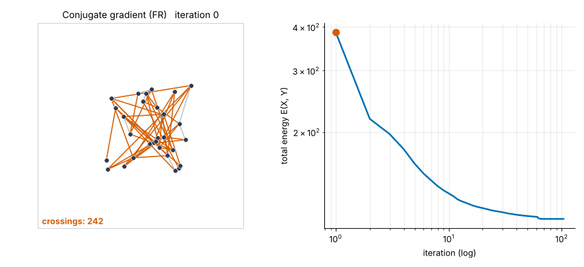
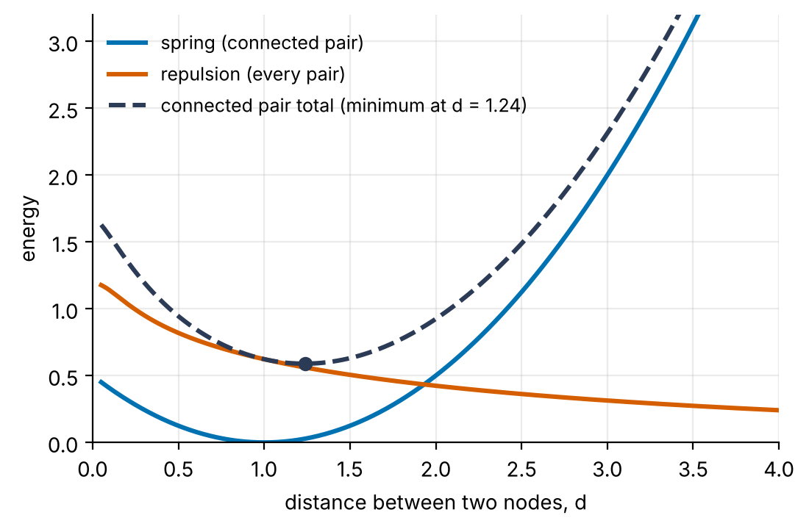
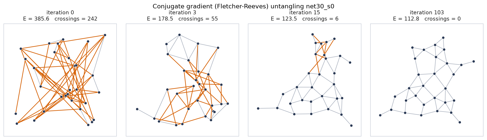
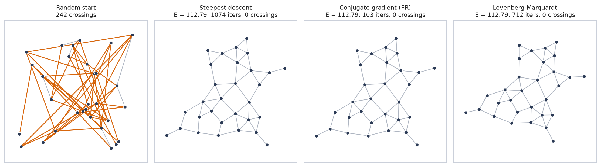
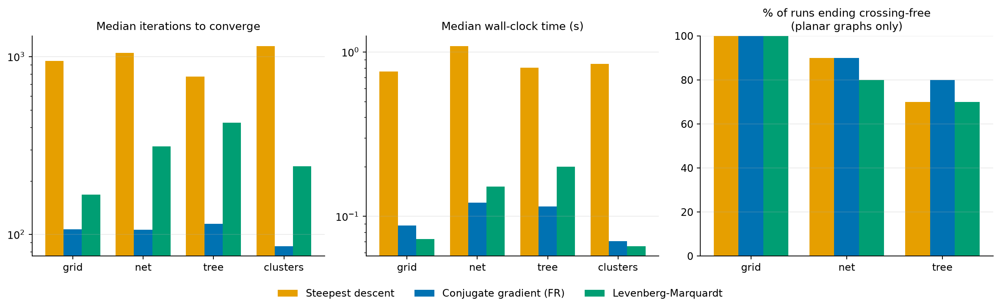
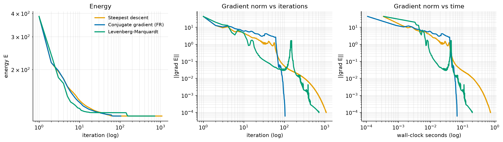

# Force-Directed Graph Layout using Unconstrained Optimization

Mini project for **Engineering Optimization** course.

## Problem Statement

Imagine building a social network, a computer network diagram, a mind map, or a software dependency graph. Although the graph defines which nodes are connected, it does not specify their positions. Randomly placing nodes often produces cluttered layouts with overlapping nodes, crossing edges, and inconsistent edge lengths, making the graph difficult to interpret.

## Proposed Solution

We formulate graph layout as an **unconstrained, multivariable, non-convex optimization problem**. Each node's \(x\) and \(y\) coordinates are decision variables, and the objective is to minimize a total energy function comprising:

- **Spring Energy:** Encourages connected nodes to maintain a target edge length.
- **Repulsion Energy:** Pushes node pairs apart to reduce crowding.
- **Centering Energy:** Keeps the overall layout from drifting excessively away from the origin.

We implement and compare three numerical optimization methods in Python using NumPy:

1. **Steepest Descent**
2. **Fletcher–Reeves Conjugate Gradient**
3. **Levenberg–Marquardt**
---

<p align="center">
  <br />
  <em>Animated untangling of a 30-node Gabriel network: from 242 crossings down to 0 in ~100 iterations.</em>
</p>

---

## Overview of Optimizers

| Method | Search Direction | Step Length Strategy | Behaviour |
|---|---|---|---|
| **Steepest Descent** | $d_k = -\nabla E$ | Bounding phase + golden-section line search | Simple, but exhibits classic zig-zagging in narrow valleys. |
| **Fletcher-Reeves CG** | $d_k = -g_k + \beta_k d_{k-1}$<br />$\beta_k = \frac{\|g_k\|^2}{\|g_{k-1}\|^2}$ | Same golden-section line search; restart every $2n$ steps or when $g^T d \ge 0$ | Blends previous direction to eliminate zig-zagging; requires no matrix inversions. |
| **Levenberg-Marquardt** | $(J^T J + \lambda \, \text{diag}(J^T J)) \delta = -J^T r$ | Trust-region / damping: $\lambda$ adapts dynamically to gain ratio $\rho$ | Gauss-Newton step when $\lambda$ is small; smooth gradient step when $\lambda$ is large. |

---

## Energy Formulation

The layout is parameterized by $z = [x_0, y_0, x_1, y_1, \dots, x_{n-1}, y_{n-1}]^T \in \mathbb{R}^{2n}$.

$$E(z) = \underbrace{\sum_{(i,j) \in \mathcal{E}} \frac{k}{2}(d_{ij} - L)^2}_{\text{Spring potential (edges)}} + \underbrace{\sum_{i < j} \frac{c L^2}{2} \ln\left(1 + \frac{R^2}{d_{ij}^2 + \varepsilon^2}\right)}_{\text{Repulsion potential (all pairs)}} + \underbrace{\frac{g}{2} \|z\|^2}_{\text{Weak gravity (centering)}}$$

* **Distance**: $d_{ij} = \|p_i - p_j\|_2$.
* **Repulsion**: A smooth version of the Fruchterman-Reingold law ($\sim -\ln d$ for $d \ll R$). The parameter $\varepsilon = 0.15$ ensures $C^\infty$ smoothness even if nodes collide.
* **Sum of Squares Structure**: The energy is expressed as a sum of squared residuals $E(z) = \frac{1}{2} r(z)^T r(z)$, meaning $\nabla E(z) = J(z)^T r(z)$. This provides the exact Gauss-Newton approximation $J^T J$ required by Levenberg-Marquardt.
* **Analytic Derivatives**: Gradients and Jacobians are computed analytically and tested against central finite differences.

<p align="center">
  <br />
  <em>Pairwise energy terms: connected nodes settle at the minimum where spring pull balances electrostatic repulsion.</em>
</p>

---

## Results Comparison & Final Layouts

### Untangling Progression (Conjugate Gradient)
Most untangling occurs within the initial 15 iterations; subsequent steps polish edge lengths until the gradient norm falls below $10^{-4}$.



### Final Layout Comparison
Starting from the identical tangled random coordinates, all three algorithms reach clean, crossing-free drawings:



---

## Benchmarks and Findings

Evaluated over **240 runs** (20 random initial seeds $\times$ 4 graph families $\times$ 3 methods), all reaching convergence ($\|\nabla E\| < 10^{-4}$):



### Convergence Profiles



### Key Insights:
1. **Conjugate Gradient is the clear winner**:
   * Achieves a median **$9.1\times$ fewer iterations** and **$9.3\times$ lower wall-clock time** compared to Steepest Descent.
   * Completely avoids steepest descent's valley zig-zagging without storing or solving matrices.
2. **Levenberg-Marquardt Tradeoffs**:
   * Needs $\approx 2.4\times$ more iterations than CG (median 250 vs 106).
   * Because springs and repulsion balance rather than vanishing at the optimum, residual magnitudes do not go to zero ($r_i \ne 0$), dropping the second-order term $\sum r_i \nabla^2 r_i$ in the Gauss-Newton Hessian and yielding linear convergence ($q \approx 0.97$).
3. **Layout Quality & Non-Convexity**:
   * Layout quality is practically identical across methods: planar graph runs end crossing-free in **SD 87%**, **CG 90%**, and **LM 83%** of runs.
   * SD and CG reach the identical local minimum in **91%** of paired starts.
   * The energy landscape is non-convex: local minima depend on the initial seed. Multi-start optimization with selection of the lowest-energy layout is recommended.

Full per-run logs and summaries are available in [`results/benchmark_runs.csv`](results/benchmark_runs.csv) and [`results/benchmark_summary.csv`](results/benchmark_summary.csv).

---

## How to Run

### Setup
```bash
pip install -r requirements.txt
```

### Run Tests (33 unit tests)
```bash
pytest -v
```

### Run Interactive Showcase Demo
Untangles a Gabriel planar network, saves figures, and builds the animated GIF in `results/`:
```bash
python scripts/run_demo.py --graph net
```

### Run Full Multi-Start Benchmark
Runs 240 optimizations across all 4 graph families (Grid, Tree, Cycle, Clusters) and 20 random seeds:
```bash
python scripts/benchmark.py --seeds 20
```
---

## Codebase Architecture

```text
forcelayout/
  ├── energy.py        # Energy E(z), analytic gradient ∇E, residuals r(z), Jacobian J(z)
  ├── linesearch.py    # 1D line search: bounding phase + golden-section search
  ├── optimizers.py    # Steepest Descent, Fletcher-Reeves CG, Levenberg-Marquardt
  ├── graphs.py        # Graph generators (grid, tree, cycle, clusters, Gabriel net)
  ├── metrics.py       # Layout quality metrics: crossings, edge CV, asymptotic rate q
  └── viz.py           # Matplotlib figures, layout plotters, and GIF generator
scripts/
  ├── run_demo.py      # Untangling showcase script
  ├── benchmark.py     # 240-run multi-start benchmark runner
  └── make_deck.js     # PowerPoint slide deck builder
tests/                 # Unit tests verifying gradients, Jacobians, and monotonicity
results/               # Benchmark data, summary JSON, figures, and GIF
docs/                  # Slide deck (force_directed_layout.pptx)
```

---

## Contributors

* **Akash Mansingh** ([@theRiddler9](https://github.com/theRiddler9))
  * GitHub: [https://github.com/theRiddler9](https://github.com/theRiddler9)
* **Gaurang Agrawal** ([@Gaurang3458](https://github.com/Gaurang3458))
  * GitHub: [https://github.com/Gaurang3458](https://github.com/Gaurang3458)
* **Repository**: [theRiddler9/force-directed-layout](https://github.com/theRiddler9/force-directed-layout)
